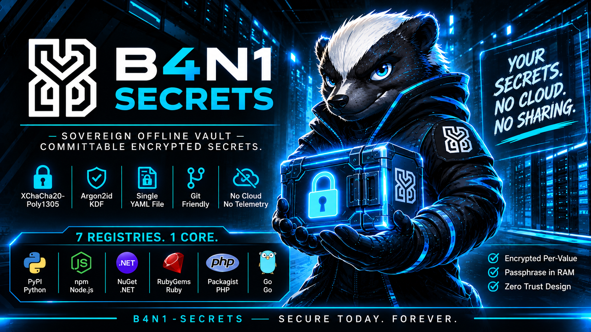

# b4n1-secrets

Sovereign offline vault — committable encrypted secrets.



**b4n1-secrets** is a self-contained, offline-first secret vault. Every value is encrypted individually (XChaCha20-Poly1305 + Argon2id) and stored in a single YAML file (`secrets.enc.yaml`) that you commit to git. The passphrase never touches disk — it lives only in RAM via a daemon, and `close` wipes it.

No SaaS. No cloud. No telemetry. One native binary, seven SDK wrappers.

## Installation — 7 registries, 1 core

| Registry | Language | Package | Command |
|----------|----------|---------|---------|
| PyPI | Python 3.8+ | b4n1-secrets | `pip install b4n1-secrets` |
| npm | Node.js | @b4n1/secrets | `npm install @b4n1/secrets` |
| NuGet | .NET / C# | b4n1-secrets | `dotnet add package b4n1-secrets` |
| RubyGems | Ruby | b4n1-secrets | `gem install b4n1-secrets` |
| Packagist | PHP 7.4+ | b4n1/b4n1-secrets | `composer require b4n1/b4n1-secrets` |
| Go | Go 1.21+ | b4n1-secrets/sdks/go | `go get github.com/B4N1-com/b4n1-secrets/sdks/go` |

All packages ship the same native core (pre-compiled, no compiler needed). The SDKs are thin wrappers that spawn the bundled binary.

## Quick Start

### Python
```python
from b4n1secrets import SecretsClient
client = SecretsClient()
print(client.version())
print(client.list(".secrets"))
```

### Node.js
```javascript
const { SecretsClient } = require('@b4n1/secrets');
const client = new SecretsClient();
console.log(client.version());
```

### .NET / C#
```csharp
using B4N1.Secrets;
var client = new SecretsClient();
Console.WriteLine(client.Version());
```

### Ruby
```ruby
require 'b4n1secrets'
client = B4n1Secrets::Client.new
puts client.version
```

### PHP
```php
$client = new \B4N1\Secrets\SecretsClient();
echo $client->version();
```

### Go
```go
import b4n1secrets "github.com/B4N1-com/b4n1-secrets/sdks/go"
client := b4n1secrets.NewClient()
v, _ := client.Version()
fmt.Println(v)
```

## CLI Usage

```bash
# Initialize a vault
echo "my-passphrase-12chars" | b4n1-secrets init .secrets

# Unlock (passphrase stays in RAM)
echo "my-passphrase-12chars" | b4n1-secrets unlock .secrets

# Set a secret
b4n1-secrets set .secrets app/API_KEY --value sk_live_... --tags prod

# Get a secret
b4n1-secrets get .secrets app/API_KEY

# List secrets (never shows values)
b4n1-secrets list .secrets

# Inject secret into a child process (never touches stdout)
b4n1-secrets run .secrets --secret API_KEY=app/API_KEY -- python my_agent.py

# Close (wipe from RAM)
b4n1-secrets close .secrets
```

## Configuration

The SDK resolves the native binary automatically. Override with an environment variable:

```bash
export B4N1SECRETS_BIN_PATH=/path/to/b4n1secrets-linux-amd64
```

## Security Model

- **mlock**: The master key is locked in RAM (not swappable to disk)
- **Zeroize**: Keys are wiped on close
- **Per-value encryption**: Each secret encrypted independently
- **`run` verb**: Secrets injected as env vars of child processes — never pass through stdout/terminal
- **No network**: Fully offline, no telemetry, no cloud

## Platform Support

| Platform | Architectures |
|----------|---------------|
| Linux | x86_64, aarch64 |
| macOS | x86_64, arm64 |
| Windows | x86_64 |

## License

Business Source License 1.1 — see LICENSE and EULA.txt.